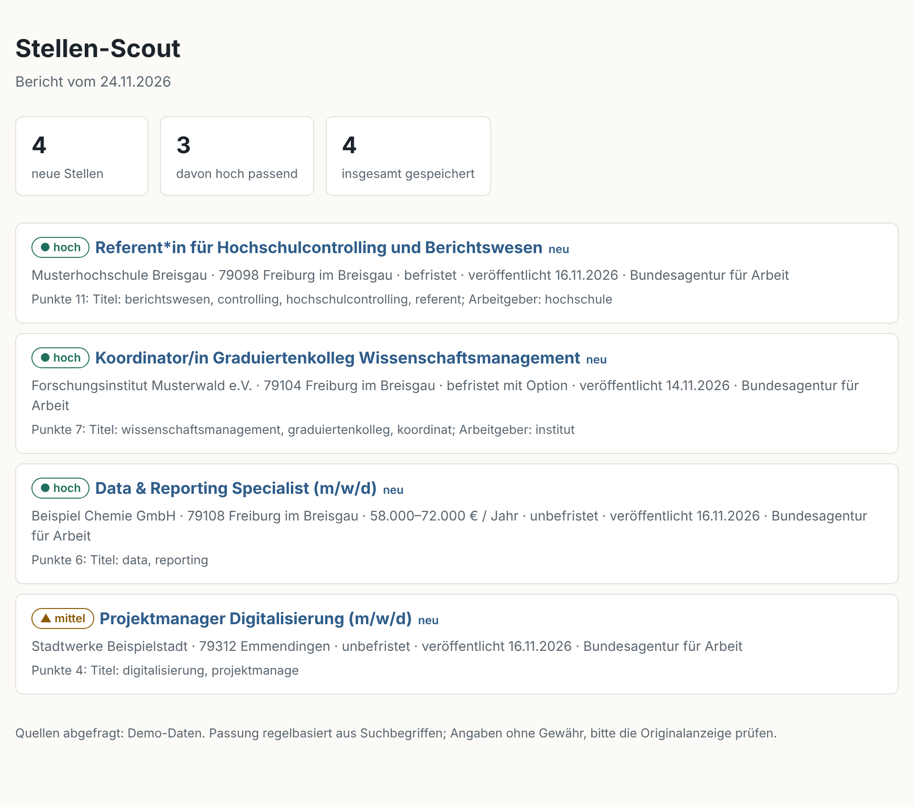

# Stellen-Scout

[](https://github.com/MelisaMus/stellen-scout/actions/workflows/tests.yml)

Ziel des Projekts: Stellenangebote aus mehreren Quellen automatisch sammeln, Dubletten erkennen,
die Passung zum eigenen Profil bewerten und täglich nur die neuen Treffer in einem kompakten
Bericht melden.

Das Projekt entstand aus einem praktischen Anwendungsfall: Bei der Stellensuche erscheinen dieselben
Anzeigen auf mehreren Portalen, mit leicht anderen Titeln, und relevante Stellen gehen zwischen
vielen unpassenden unter.



*Beispielbericht, erzeugt mit `--demo` aus fiktiven Daten.*

## Was das Tool macht

- ruft Stellen aus der **Jobbörse der Bundesagentur für Arbeit** ab (Jobsuche-Schnittstelle, Version 6),
  inklusive Gehaltsspanne und Befristung, sofern angegeben
- liest zusätzlich **RSS-Feeds** und **Stellenlisten auf Webseiten**, etwa von Hochschulen
- erkennt **Dubletten** über einen normalisierten Schlüssel aus Titel, Arbeitgeber und Ort
  („Referent\*in (m/w/d)“ und „Referentin (w/m/d)“ gelten als dieselbe Stelle)
- **bewertet die Passung** regelbasiert: gewichtete Suchbegriffe in Titel und Text,
  bevorzugte Arbeitgeberarten, Ausschlusswörter; jede Bewertung nennt ihre Begründung
- speichert alle Stellen in **SQLite** und meldet nur, was **neu** ist
- erzeugt einen **HTML-Bericht** und eine **CSV-Datei** (öffnet sich mit Umlauten in Excel)
- optional: **KI-Kommentar** je Stelle über die Anthropic-API und **Versand per E-Mail**
- läuft werktags automatisch und kostenlos über **GitHub Actions**

## Ablauf

```
Konfiguration (Suchbegriffe, Quellen, Gewichte)
     ↓
Quellen abfragen: Arbeitsagentur · RSS · Webseiten
     ↓
Dubletten zusammenführen
     ↓
Bewertung und Filter
     ↓
SQLite: neue Stellen erkennen
     ↓
optional KI-Kommentar
     ↓
HTML-Bericht · CSV · optional E-Mail
```

## Tech Stack

Python 3.11+, Requests, BeautifulSoup, SQLite, pytest, GitHub Actions.

## Projektstruktur

```
stellen-scout/
├── stellen_scout/
│   ├── cli.py             Ablauf und Kommandozeile
│   ├── models.py          Datenmodell einer Stelle
│   ├── sources/
│   │   ├── ba.py          Jobbörse der Bundesagentur für Arbeit
│   │   ├── rss.py         RSS- und Atom-Feeds
│   │   └── html_list.py   Stellenlisten auf Webseiten
│   ├── dedupe.py          Normalisierung und Dubletten
│   ├── scoring.py         regelbasierte Bewertung
│   ├── ai_scoring.py      optionaler KI-Kommentar
│   ├── store.py           SQLite-Speicher
│   ├── report.py          HTML- und CSV-Bericht
│   ├── notify.py          optionaler E-Mail-Versand
│   └── demo_data.json     fiktive Beispieldaten
├── tests/                 pytest, mit fiktiven Beispieldaten
├── docs/                  Screenshot für dieses README
├── config.example.json
└── .github/workflows/
    ├── stellen-scout.yml  täglicher Lauf
    └── tests.yml          Tests bei jedem Push
```

## Schnellstart

```bash
python -m venv .venv
source .venv/bin/activate          # Windows: .venv\Scripts\activate
pip install -r requirements-dev.txt

cp config.example.json config.json

# Ohne Internet, mit fiktiven Beispieldaten:
python -m stellen_scout --demo --no-mail

# Echter Lauf:
python -m stellen_scout --no-mail
```

Der Bericht liegt danach unter `reports/bericht-aktuell.html`.

Tests: `pytest`

### In Google Colab

```python
!git clone https://github.com/MelisaMus/stellen-scout.git
%cd stellen-scout
%pip install -q -r requirements.txt
!cp config.example.json config.json
!python -m stellen_scout --no-mail

from IPython.display import HTML
HTML(open("reports/bericht-aktuell.html", encoding="utf-8").read())
```

Colab löscht Dateien beim Beenden der Sitzung. Damit die Datenbank erhalten bleibt und am nächsten
Tag nur neue Stellen erscheinen, das Projekt in Google Drive ablegen.

## Konfiguration

Alles Anpassbare steht in `config.json`:

| Bereich | Inhalt |
| --- | --- |
| `search_terms` | Suchbegriffe für die Arbeitsagentur; dienen auch zum Erkennen von Stellen auf Webseiten |
| `bundesagentur` | Ort, Umkreis in km, Zeitraum in Tagen, Zeitarbeit ja/nein |
| `sources` | weitere Quellen vom Typ `rss` oder `html` |
| `scoring` | Gewichte für Titel, Text und Arbeitgeber, Ausschlusswörter, Schwellen für „hoch“ und „mittel“ |
| `ai` | KI-Kommentar an/aus, Modell, Höchstzahl pro Lauf, Kurzprofil |
| `report` | bereits bekannte Stellen mit anzeigen; E-Mail auch ohne neue Treffer |

### Weitere Quelle hinzufügen

**RSS-Feed:** Typ `rss`, URL des Feeds, fertig.

**Webseite:** Typ `html` und die URL der Stellenliste. Ohne weitere Angaben nimmt das Tool alle Links,
deren Text nach einer Stellenanzeige aussieht (enthält „(m/w/d)“ o. ä. oder einen Suchbegriff).
Für präzisere Ergebnisse lassen sich CSS-Selektoren angeben (`item_selector`, `title_selector`,
`link_selector`), die man mit den Entwicklerwerkzeugen des Browsers findet.

## Automatisch über GitHub Actions

Der Workflow `.github/workflows/stellen-scout.yml` läuft werktags am frühen Morgen und lässt sich
unter **Actions → Stellen-Scout → Run workflow** auch von Hand starten. Der Bericht erscheint als
Download unter dem jeweiligen Lauf. Die Datenbank wird im Actions-Cache aufbewahrt, damit nur neue
Stellen gemeldet werden.

Optionale Geheimnisse unter **Settings → Secrets and variables → Actions**:

| Name | Wofür |
| --- | --- |
| `ANTHROPIC_API_KEY` | KI-Kommentar (zusätzlich `"ai": {"enabled": true}` in der Konfiguration) |
| `SMTP_HOST`, `SMTP_PORT`, `SMTP_USER`, `SMTP_PASSWORD`, `MAIL_TO` | Bericht per E-Mail; bei Gmail ein App-Passwort verwenden |

Hinweis: `config.json` ist über `.gitignore` ausgeschlossen und bleibt lokal. Der Workflow nutzt
deshalb `config.example.json`. Wer dort eigene Suchbegriffe einträgt, macht sie in einem öffentlichen
Repository sichtbar; das Kurzprofil für die KI-Bewertung gehört nicht dorthin.

## Fairer Umgang mit Quellen

- Die Jobsuche-Schnittstelle der Arbeitsagentur ist öffentlich nutzbar, aber **keine offiziell
  garantierte API**; sie ist von der Community unter
  [bundesAPI/jobsuche-api](https://github.com/bundesAPI/jobsuche-api) dokumentiert.
  Pfad und Version sind daher konfigurierbar (`bundesagentur.endpoint`).
- Webseiten und Feeds werden nur abgerufen, wenn ihre `robots.txt` es erlaubt, mit Pause zwischen
  den Abrufen und eindeutigem User-Agent.
- Portale, deren Nutzungsbedingungen automatisiertes Auslesen verbieten (z. B. LinkedIn, Indeed,
  StepStone), sind bewusst nicht eingebunden. Dort sind die eingebauten E-Mail-Benachrichtigungen
  der bessere Weg.

## Datenschutz

Verarbeitet werden nur öffentlich zugängliche Stellenanzeigen. Die optionale KI-Bewertung sendet
Titel, Arbeitgeber, Ort und Kurzbeschreibung neuer Stellen sowie das Kurzprofil aus der Konfiguration
an die Anthropic-API. `config.json`, Datenbank und Berichte sind in `.gitignore` ausgeschlossen.

## Entwicklungsansatz

Das Projekt wurde KI-gestützt entwickelt. Problemdefinition, Anforderungen, Bewertungslogik und
Prüfung der Ergebnisse erfolgten am konkreten Anwendungsfall der eigenen Stellensuche.

Ein Beispiel aus dem Betrieb: Beim ersten Lauf gegen die echte Schnittstelle lieferte Version 4
nur noch den Fehler 403. Eine Diagnoseabfrage zeigte, dass Version 6 antwortet, aber mit anderer
Struktur (`ergebnisliste` statt `stellenangebote`, Ort in `stellenlokationen`, neue Felder für
Gehaltsspanne und Befristung). Der Adapter liest seitdem die Feldnamen beider Versionen; ein Test
mit dem Aufbau einer echten v6-Antwort sichert das ab.

## Grenzen

- Die Bewertung ist regelbasiert und erkennt Bedeutung nur über Wörter; „Controlling“ im Titel einer
  Stelle für Lagerlogistik zählt genauso wie im Hochschulcontrolling.
- Die Arbeitsagentur liefert in der Trefferliste keinen Beschreibungstext und keine Bewerbungsfrist;
  beides steht nur in der Anzeige selbst.
- Stellenlisten auf Webseiten liefern meist nur Titel und Link; Webseiten, die ihre Liste per
  JavaScript nachladen, brauchen einen eigenen Adapter.
- Läuft das Tool mehrmals am selben Tag, bleiben die Stellen dieses Tages als „neu“ markiert.

## Mögliche Weiterentwicklung

- Bewerbungsfrist und Entgeltgruppe aus der Detailansicht der Anzeige lesen
- Merkliste und Bewerbungsstatus je Stelle
- Dashboard über die gesammelten Daten (z. B. Anzahl passender Stellen pro Woche und Region)

## Lizenz

[MIT](LICENSE)
